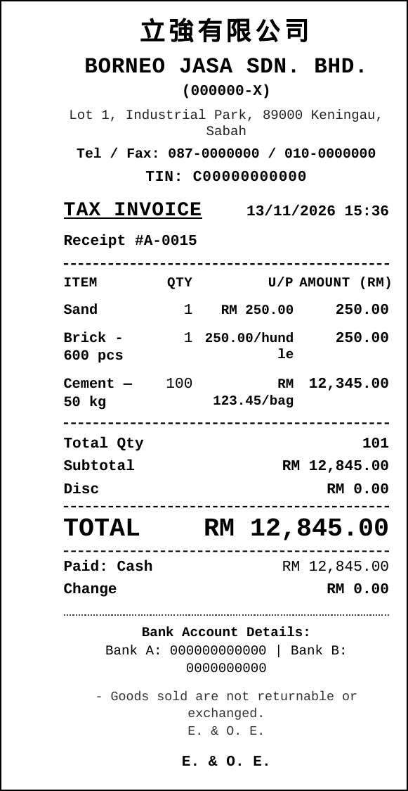
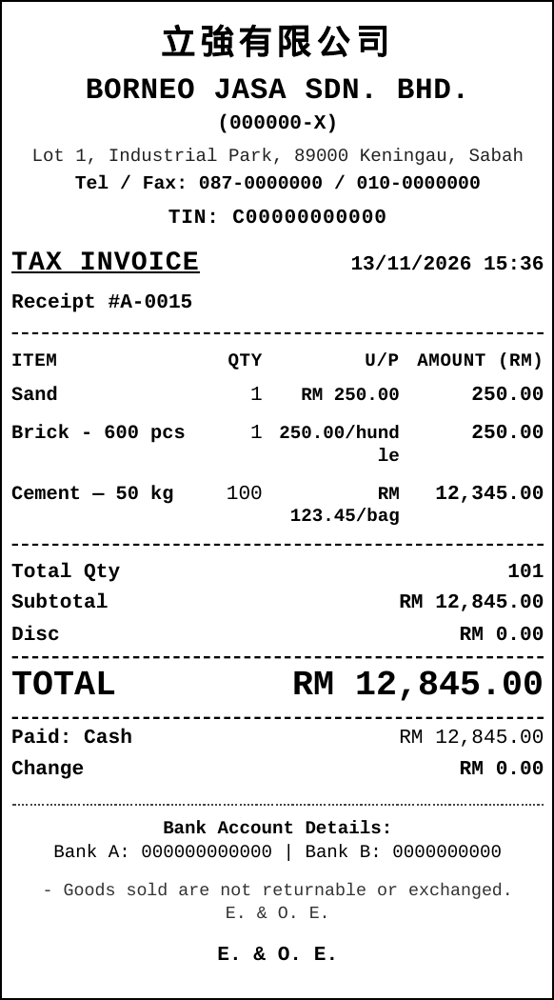

# Receipt centering on an 80 mm Xprinter

Measured from the same receipt HTML, printed with Electron `printToPDF` using the print path's margins (`marginType: "none"`) and the same physical page size. `webContents.print` takes `pageSize` in microns; `printToPDF` takes inches, so the proof converts `microns / 25400`. Rasters are 203 dpi (`pdftoppm -r 203`). Ink is any pixel with a channel below 245. The black frame on the screenshots was drawn after measurement so the page edge is visible; it is not part of the print.

An 80 mm Xprinter head is 576 dots, 72 mm. The Windows driver puts the page origin on the left edge of that head, so the right 8 mm of an 80 mm page never reaches the paper. v0.1.8 still sent an 80 mm page (`80_000` × `297_000` microns) and centered a 60 mm body inside it with `margin: 0 auto`.

## v0.1.8

Page `227.04 × 841.92` pt (80.09 × 297.01 mm). Raster `641 × 2374` px.

| Where measured | Left blank | Right blank | Difference |
| --- | ---: | ---: | ---: |
| Full 80 mm page | 88 px | 87 px | 1 px |
| Left 72 mm of that page (the head, 577 px) | 88 px | 23 px | 65 px |

The 60 mm body is centered on the 80 mm page, which is why the full-page blanks match. On the head it sits about 4 mm right of center (88 px vs 23 px). Nothing in this render fell into the discarded right 8 mm — the 60 mm body ends about 2.9 mm inside the head — but that is the whole of the remaining right margin. v0.1.5–v0.1.7 used the same 80 mm page and only changed how far the body was inset, so the center stayed 4 mm to the right.

## v0.1.9

The page is the printable width: 72 mm for 80 mm paper, 48 mm for 58 mm paper. `@page` and `receiptPageSize` both use that width (`72_000` × `297_000` microns for an 80 mm roll). The body is that wide, `margin: 0`, with 1 mm padding on each side.

Page `204.96 × 841.92` pt (72.31 × 297.01 mm). Raster `578 × 2374` px.

| Left blank | Right blank | Difference |
| ---: | ---: | ---: |
| 10 px | 9 px | 1 px |

Both sides are clear of the edge. `12,345.00` and the `AMOUNT (RM)` header sit in an 18 mm column (Courier New at 7.5 pt / 6.8 pt is about 14.3 mm / 16.6 mm).

## Driver settings for the shop

In the Xprinter Windows driver (XP-80 class):

- Paper: **80(72.1) × 297 mm**, or **80(72.1) × 3276 mm** if the roll is set up as one long page
- Margins: **0**
- Scaling: **none** (100%, not fit-to-page)

The app sends a 72 mm page, just inside the driver's 72.1 mm printable width, with the origin on the left edge of the head.
